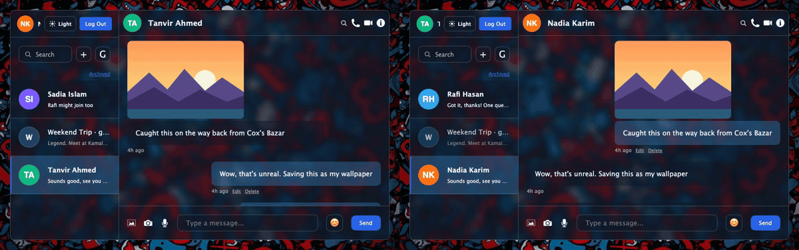
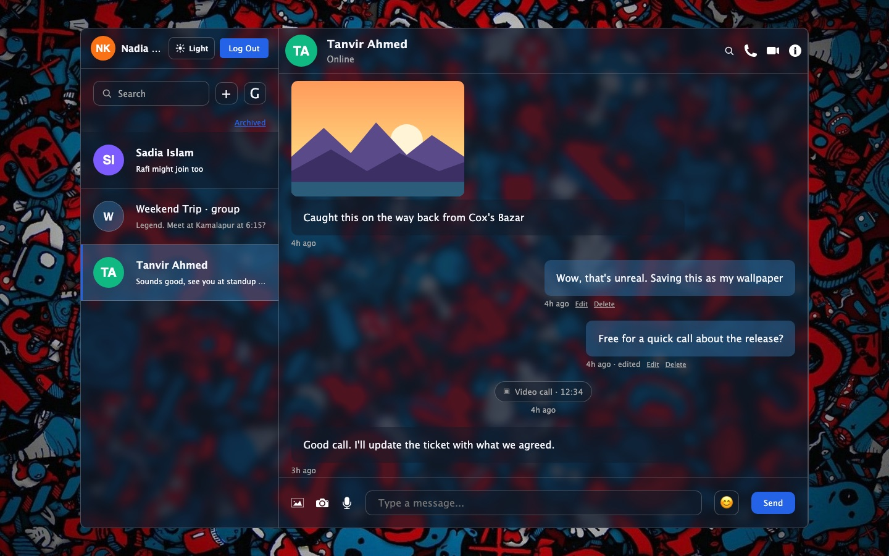
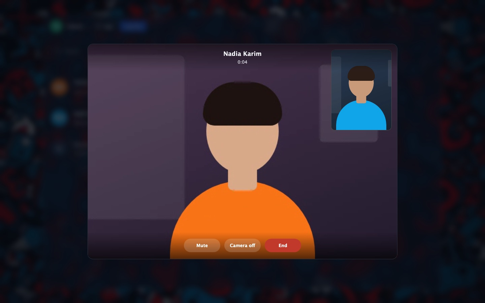
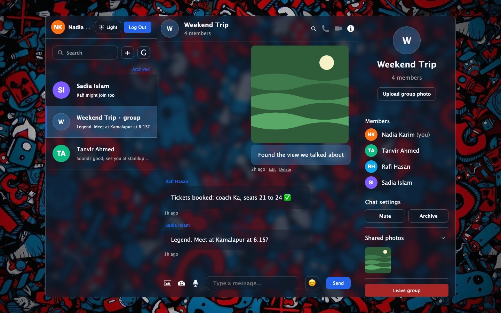
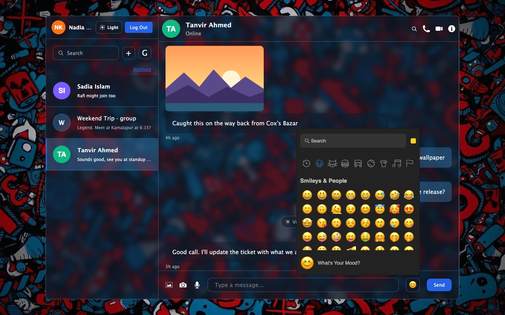
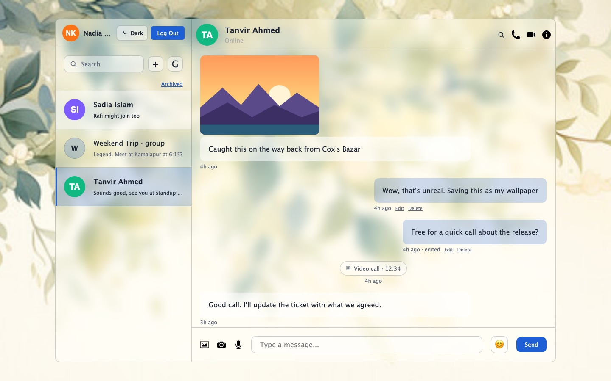
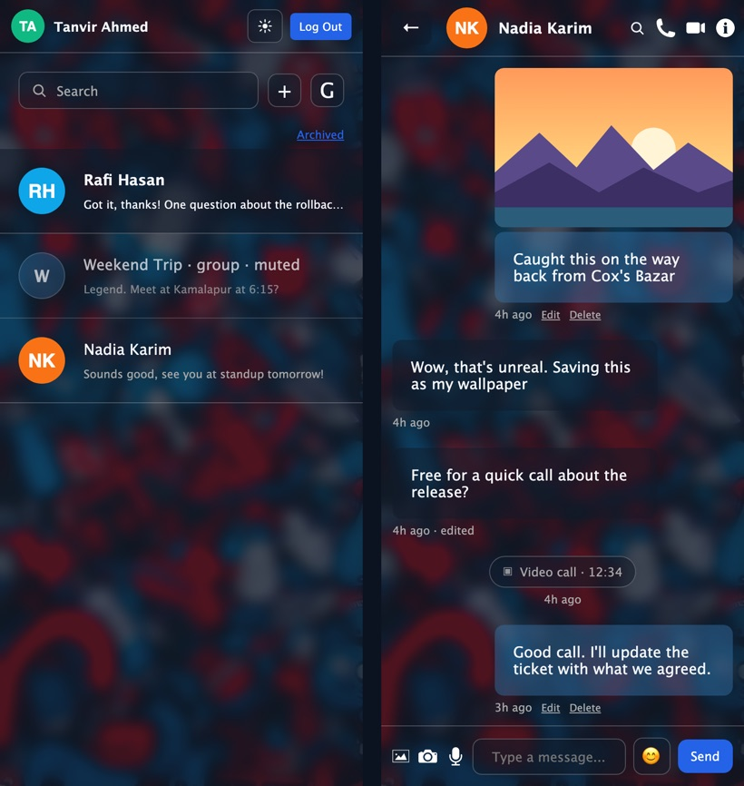
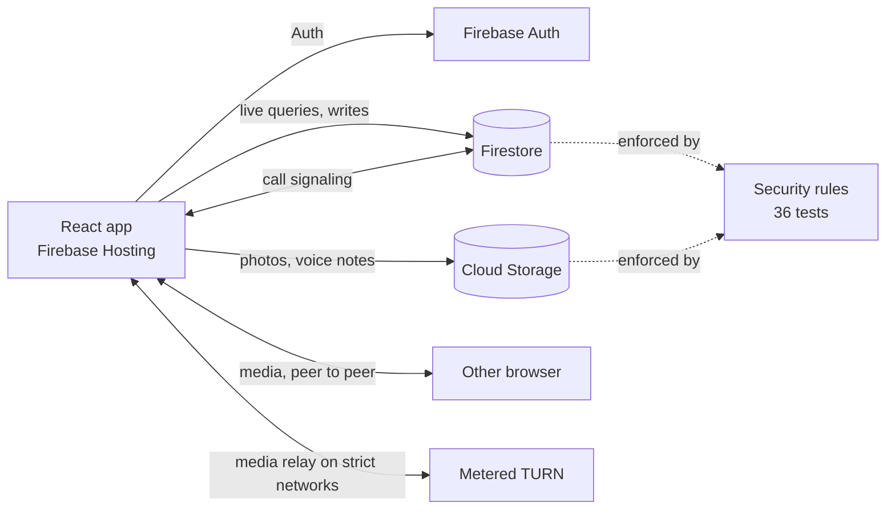

# React Chat App

[](https://github.com/4K45H107/react-chat-app/actions/workflows/ci.yml)
[](./LICENSE)

**Real-time chat with group messaging and WebRTC voice and video calls**, built on React and
Firebase, with no backend of its own. Security rules do the job of an API's authorization layer,
and they're tested like code.

**Live demo: [reactchat-ed5f2.web.app](https://reactchat-ed5f2.web.app)**

| Sign in as | Email | Password |
| --- | --- | --- |
| Nadia Karim | `nadia@reactchat.dev` | `Password123!` |
| Tanvir Ahmed | `tanvir@reactchat.dev` | `Password123!` |

Open the two accounts in two browsers (or a normal and a private window) to see messages arrive
live and to call one another. The demo data resets every night.



## Screenshots

| | |
| --- | --- |
|  |  |
| **Conversation:** photos, edits, call history, unread state | **Video call:** WebRTC, with a TURN relay for strict networks |
|  |  |
| **Groups:** members, mute and archive, shared photos | **Emoji picker:** loaded on first use |
|  |  |
| **Light and dark themes** | **Responsive** down to phone size |

## Features

| Area | What it does |
| --- | --- |
| Messaging | One-to-one and group chats, edit, soft delete, emoji, search inside a chat, paginated history |
| Real time | Live sidebar and thread, typing indicator, online status, read state, browser notifications |
| Media | Photos, camera capture, voice notes, shared photos panel |
| Calls | One-to-one voice and video over WebRTC, ringing, busy and missed states, call history in the thread |
| People | Find users, start a chat once per pair, block and unblock, mute and archive, leave a group |
| Polish | Light and dark themes, phone layout, keyboard navigation and ARIA labels |

## Architecture



- **No backend of its own:** the app talks to Firebase directly, and **security rules are the
  authorization layer**.
- **The sidebar is a query** over the chats you belong to. Each chat holds its last-message preview
  and a read marker per member, so **no user ever writes another user's documents**.
- **Calls** use Firestore to exchange the WebRTC offer, answer and ICE candidates. Media goes peer
  to peer, or through the TURN relay when the networks can't connect directly.
- **Data access** lives in two service modules (`chatService`, `callService`). Components never
  touch the data model directly.

Why each of these was chosen: [architecture decision records](docs/adr/README.md).

## Security

| Rule | Enforced in `firestore.rules` |
| --- | --- |
| Members only | Strangers can't read or list a chat or its messages |
| Private settings | Mute and archive live in a document only its owner can read |
| No impersonation | Messages, previews and read markers are written as yourself, at server time |
| No backdating | Message and edit timestamps must equal `request.time` |
| One chat per pair | Direct chat ids are the sorted pair of user ids |
| Groups | Members can leave; nobody can add or remove anyone else |
| Blocking | Messages, new chats and calls are refused once either side blocks |
| Calls | Only the callee can answer or decline; an ended call can't be reopened |
| No emails exposed | Profiles hold no email; the rules reject one |

The rules are covered by **36 tests** on the Firestore emulator. Run against the rules this
project started with, 18 of them fail, one for each hole that was closed.
[Data model and security](docs/data-model.md)

## Performance

The bundle is split at sign-in: the login screen downloads only React and Firebase Auth, and the
signed-in app is prefetched while the user types their password.

| | Before | After |
| --- | --- | --- |
| JavaScript for the first screen (gzip) | 282 KB | **84 KB** |
| Emoji picker (62 KB gzip) | always | on first open |
| Firebase Storage (12 KB gzip) | always | on first upload |

Size budgets for each chunk run in CI, so it can't quietly grow back.

## Quality

- **36 rules tests** and **11 integration tests** run against the Firebase emulators. The
  integration tests drive the app's real services through sign-in, messaging, groups, calls,
  blocking and sign-up.
- **Unit tests**, ESLint with zero warnings, and bundle size budgets.
- **CI on every pull request**, and **auto-deploy** to Firebase Hosting from `main` once
  everything passes.

## Tech stack

| Area | Choices |
| --- | --- |
| UI | React 18, Vite 5, CSS with theme variables |
| State | Zustand |
| Backend services | Firebase Auth, Firestore (offline cache), Cloud Storage, Firebase Hosting |
| Calls | WebRTC, Firestore signaling, Metered TURN |
| Testing | Vitest, `@firebase/rules-unit-testing`, Firebase Emulator Suite |
| Tooling | ESLint, size-limit, GitHub Actions |

## Running it locally

Requirements: Node 24+, and Java 21+ for the Firebase emulators.

Everything runs against local emulators, with the same demo data as the live site:

```bash
npm install
npm run emulators         # terminal 1: Auth, Firestore, Storage (UI on :4000)
npm run seed:emulators    # terminal 2: demo accounts and chats
npm run dev:emulators     # terminal 2: open the URL, sign in as nadia@reactchat.dev / Password123!
```

To run against a Firebase project instead, copy `.env.example` to `.env`, fill in the values,
and run `npm run dev`.

| Command | What it does |
| --- | --- |
| `npm run dev` | Development server |
| `npm run build` | Production build |
| `npm run lint` | ESLint |
| `npm test` | Unit tests |
| `npm run test:rules` | Firestore rules tests (emulator) |
| `npm run test:integration` | End-to-end flows against seeded emulators |
| `npm run size` | Bundle size budgets (after a build) |

## Documentation

| Doc | What's in it |
| --- | --- |
| [Architecture](docs/architecture.md) | Stack, folders, state, code splitting |
| [Data model and security](docs/data-model.md) | Collections, fields, indexes, what the rules allow |
| [Calls](docs/calls.md) | WebRTC signaling, call states, the TURN relay |
| [Testing](docs/testing.md) | Emulators, rules and integration tests, demo data, CI |
| [Deployment](docs/deployment.md) | Hosting, the deploy pipeline, the nightly demo reset |
| [Decision records](docs/adr/README.md) | Why it's built this way |

## Limitations

- Calls are one-to-one; group chats have messaging only.
- Upload rate limits run in the client; Storage rules still cap file size and type.
- Notifications use the browser Notification API, so they need an open tab.

## License

[MIT](./LICENSE) © Fahad Ahmed Akash
